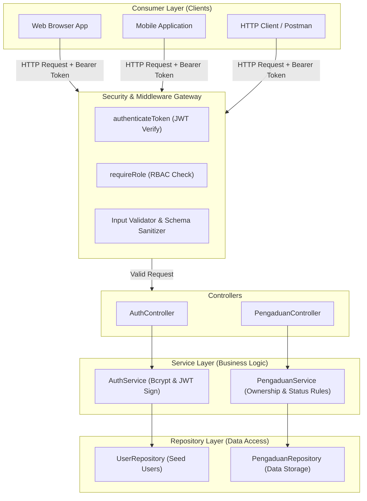

# LAPORAN UJIAN TENGAH SEMESTER (UTS)
## Web Service Engineering (WSE)
**Merancang dan Membangun REST API yang Aman, Terstruktur, dan Dapat Dipertanggungjawabkan**

---

* **Nama Mahasiswa:** Rahmat Allam  
* **NIM:** 240104040182  
* **Program Studi:** Teknologi Informasi  
* **Mata Kuliah:** Web Service Engineering (3 SKS)  
* **Dosen Pengampu:** Muhayat, M.IT  
* **Nama Proyek:** SIMADU API (*Sistem Layanan Informasi dan Pengaduan Mahasiswa*)  
* **Teknologi:** Node.js, Express 5, JSON, JWT, Bcrypt, Swagger UI / OpenAPI 3.0  

---

## DAFTAR ISI
1. [BAB I: Analisis Kebutuhan dan Perancangan REST API](#bab-i-analisis-kebutuhan-dan-perancangan-rest-api)
2. [BAB II: Arsitektur dan Struktur Proyek](#bab-ii-arsitektur-dan-struktur-proyek)
3. [BAB III: Mekanisme Keamanan dan Kontrol Akses](#bab-iii-mekanisme-keamanan-dan-kontrol-akses)
4. [BAB IV: Hasil Pengujian Fungsional dan Keamanan (12 Skenario)](#bab-iv-hasil-pengujian-fungsional-dan-keamanan-12-skenario)
5. [BAB V: Dokumentasi Teknis dan Swagger UI](#bab-v-dokumentasi-teknis-dan-swagger-ui)
6. [BAB VI: Jawaban 10 Pertanyaan Demonstrasi UTS](#bab-vi-jawaban-10-pertanyaan-demonstrasi-uts)

---

## BAB I: Analisis Kebutuhan dan Perancangan REST API

### 1.1 Identifikasi Aktor Sistem
Sistem SIMADU API melayani dua aktor utama dengan hak istimewa yang berbeda:
1. **Mahasiswa (`mahasiswa`)**:
   - Pengguna layanan kampus yang berhak menyampaikan laporan/pengaduan terkait fasilitas, akademik, dan teknologi informasi.
   - Hak akses dibatasi hanya untuk melihat, mengubah, dan menghapus pengaduan miliknya sendiri yang masih berstatus `diajukan`.
2. **Administrator Kampus (`admin`)**:
   - Pengelola operasional kampus yang bertugas memantau seluruh pengaduan dari seluruh mahasiswa.
   - Memiliki kewenangan memperbarui status tindak lanjut pengaduan (`diajukan` $\rightarrow$ `diproses` $\rightarrow$ `selesai`).
   - Tidak diperkenankan membuat pengaduan mahasiswa atau mengubah isi deskripsi laporan.

### 1.2 Identifikasi Resource Utama
Resource utama sistem adalah **`pengaduan`** dengan atribut data sebagai berikut:

| Field | Tipe Data | Keterangan | Validasi / Aturan |
| :--- | :--- | :--- | :--- |
| `id` | Integer | Identitas unik pengaduan | Auto-increment, *read-only* |
| `mahasiswaId` | String | Identitas pemilik pengaduan | Diambil otomatis dari token autentikasi |
| `judul` | String | Judul pengaduan | Wajib diisi, non-kosong |
| `kategori` | String | Kategori pengaduan | Wajib: `Fasilitas`, `Akademik`, atau `TI` |
| `deskripsi` | String | Uraian lengkap pengaduan | Wajib diisi, non-kosong |
| `status` | String | Status penanganan | Nilai: `diajukan`, `diproses`, `selesai` (default: `diajukan`) |
| `createdAt` | String | Timestamp pembuatan | Format ISO 8601 UTC otomatis dari server |

---

### 1.3 Tabel Kontrak Endpoint REST API

| No | Metode | Endpoint | Request Body | Status Sukses | Status Gagal | Deskripsi |
| :---: | :---: | :--- | :--- | :---: | :---: | :--- |
| 1 | `POST` | `/api/auth/login` | `{ username, password }` | 200 OK | 400, 401 | Autentikasi user & pengembalian JWT token |
| 2 | `GET` | `/api/pengaduan` | *- none -* | 200 OK | 401 | Mengambil daftar pengaduan (filtered by role) |
| 3 | `GET` | `/api/pengaduan/:id` | *- none -* | 200 OK | 401, 403, 404 | Mengambil detail 1 pengaduan |
| 4 | `POST` | `/api/pengaduan` | `{ judul, kategori, deskripsi }` | 201 Created | 400, 401, 403 | Menambahkan pengaduan baru (Mahasiswa) |
| 5 | `PUT` | `/api/pengaduan/:id` | `{ judul, kategori, deskripsi }` | 200 OK | 400, 401, 403, 404 | Memperbarui isi pengaduan (Status `diajukan`) |
| 6 | `PATCH` | `/api/pengaduan/:id/status` | `{ status }` | 200 OK | 400, 401, 403, 404 | Memperbarui status penanganan (Admin) |
| 7 | `DELETE` | `/api/pengaduan/:id` | *- none -* | 200 OK | 400, 401, 403, 404 | Menghapus pengaduan (Status `diajukan`) |

---

### 1.4 Diagram Komunikasi Consumer-Provider & Arsitektur Sistem



---

## BAB II: Arsitektur dan Struktur Proyek

Proyek ini dibangun menggunakan **Arsitektur Berlapis (*Layered Architecture*)** dengan prinsip *Separation of Concerns* (SoC):

```text
simadu-api/
├── src/
│   ├── routes/          # Definisi rute URL dan mapping ke controller
│   ├── controllers/     # Menerima req HTTP, delegasi ke service, kirim response
│   ├── services/        # Logika bisnis inti, aturan otorisasi & validasi status
│   ├── repositories/    # Abstraksi penyimpanan dan manipulasi data
│   └── middleware/      # Keamanan token, otorisasi peran, validasi, & error handler
├── docs/
│   └── openapi.json     # Kontrak antarmuka OpenAPI 3.0
├── tests/
│   ├── test-runner.cjs  # Skrip pengujian otomatis 12 skenario
│   └── simadu_api.postman_collection.json # Ekspor koleksi Postman
├── app.cjs              # Konfigurasi Express, middleware global, Swagger route
├── server.cjs           # Entrypoint listener HTTP server
├── package.json         # Konfigurasi dependensi dan skrip proyek
├── .env.example         # Template konfigurasi variabel lingkungan
└── README.md            # Dokumentasi panduan operasional proyek
```

### Pembagian Tanggung Jawab Komponen:
1. **Router (`src/routes/`)**: Bertanggung jawab menerima URI dan metode HTTP, lalu memanggil middleware autentikasi/validasi serta mengarahkan aliran ke Controller yang sesuai.
2. **Controller (`src/controllers/`)**: Bertanggung jawab mengekstrak parameter dari request (`req.body`, `req.params`, `req.user`), memanggil method di Service, dan menyusun HTTP response status code serta payload JSON.
3. **Service (`src/services/`)**: Tempat seluruh aturan bisnis (*business logic*) dieksekusi, seperti verifikasi kepemilikan data (`mahasiswaId === user.id`), verifikasi apakah status masih `diajukan`, serta perhitungan data.
4. **Repository (`src/repositories/`)**: Lapisan abstraksi penyimpanan data. Menyediakan operasi manipulasi data (*Find, Create, Update, Delete*) tanpa terikat langsung pada framework web.
5. **Middleware (`src/middleware/`)**: Komponen penjaga (*gatekeeper*) yang dieksekusi sebelum request mencapai controller. Melakukan verifikasi token JWT, pengecekan peran user, validasi payload JSON, dan menangani error secara terpusat (*Global Error Handler*).

---

## BAB III: Mekanisme Keamanan dan Kontrol Akses

1. **Penyimpanan Password Aman**: Password user tidak pernah disimpan dalam bentuk plaintext, melainkan di-hash menggunakan algoritma **Bcrypt** dengan salt round 10 (`bcrypt.hashSync()`).
2. **Autentikasi Bearer Token (JWT)**: Login yang berhasil akan mengembalikan JSON Web Token (JWT) yang memuat identitas pengguna (`id`, `username`, `nama`, `role`) serta waktu kedaluwarsa (`expiresIn: '1h'`). Token diverifikasi di setiap pemanggilan endpoint terlindungi melalui header `Authorization: Bearer <token>`.
3. **Kontrol Akses Berbasis Peran & Kepemilikan (RBAC & Data Ownership)**:
   - Admin diizinkan melihat semua pengaduan dan mengupdate status.
   - Mahasiswa hanya diizinkan melihat pengaduannya sendiri. Jika mahasiswa mencoba mengakses atau mengubah pengaduan mahasiswa lain, server langsung menolak dengan status **403 Forbidden**.
   - Identitas pemilik (`mahasiswaId`) disuntikkan secara otomatis oleh server dari token JWT, sehingga client tidak dapat memalsukan identitas pengadu.
4. **Validasi Input Ketat**:
   - Field `kategori` divalidasi harus salah satu dari: `Fasilitas`, `Akademik`, `TI`.
   - Field yang dilindungi seperti `id`, `mahasiswaId`, `status`, dan `createdAt` dilarang dikirim oleh client pada saat pembuatan/pembaruan pengaduan (otomatis ditolak dengan status **400 Bad Request**).
5. **Penanganan Error Terpusat**:
   - Seluruh error diteruskan ke `error.middleware.cjs`.
   - Menghasilkan format JSON standar `{ success: false, message: "..." }` dengan status HTTP yang tepat (400, 401, 403, 404, 500) tanpa mengekspos informasi sensitif atau jejak tumpukan kode (*stack trace*).

---

## BAB IV: Hasil Pengujian Fungsional dan Keamanan (12 Skenario)

Pengujian dilakukan menggunakan modul otomatisasi `tests/test-runner.cjs` serta verifikasi menggunakan Postman. Seluruh 12 skenario pengujian berhasil memenuhi kontrak yang diharapkan (*100% Passed*).

### Tabel Rekapitulasi Hasil Pengujian

| No | Skenario Pengujian | Metode & Endpoint | Header / Payload | Ekspektasi | Hasil Aktual | Status |
| :---: | :--- | :--- | :--- | :---: | :---: | :---: |
| **1** | Login dengan kredensial benar | `POST /api/auth/login` | Body: `{"username":"mhs_budi", "password":"password123"}` | **200**, token diterima | **200 OK** | **PASSED** |
| **2** | Login dengan password salah | `POST /api/auth/login` | Body: `{"username":"mhs_budi", "password":"wrongpassword"}` | **401** | **401 Unauthorized** | **PASSED** |
| **3** | Akses endpoint tanpa token | `GET /api/pengaduan` | Header: *Tanpa header Authorization* | **401** | **401 Unauthorized** | **PASSED** |
| **4** | Akses token tidak valid | `GET /api/pengaduan` | Header: `Authorization: Bearer token_palsu_123` | **401** | **401 Unauthorized** | **PASSED** |
| **5** | Mahasiswa buat pengaduan valid | `POST /api/pengaduan` | Token Mhs 1, Body: valid (judul, kategori, deskripsi) | **201** | **201 Created** | **PASSED** |
| **6** | Mahasiswa baca pengaduan sendiri | `GET /api/pengaduan/1` | Token Mhs 1 (Pemilik pengaduan ID 1) | **200** | **200 OK** | **PASSED** |
| **7** | Mahasiswa coba baca pengaduan orang lain | `GET /api/pengaduan/3` | Token Mhs 1 (Pengaduan ID 3 milik Mhs 2) | **403** | **403 Forbidden** | **PASSED** |
| **8** | Mahasiswa ubah status pengaduan | `PATCH /api/pengaduan/1/status` | Token Mhs 1, Body: `{"status":"selesai"}` | **403** | **403 Forbidden** | **PASSED** |
| **9** | Admin melihat seluruh pengaduan | `GET /api/pengaduan` | Token Admin | **200** | **200 OK** | **PASSED** |
| **10** | Admin memperbarui status pengaduan | `PATCH /api/pengaduan/1/status` | Token Admin, Body: `{"status":"diproses"}` | **200** | **200 OK** | **PASSED** |
| **11** | Buat pengaduan field wajib kosong | `POST /api/pengaduan` | Token Mhs 1, Body: `{"judul":"", "deskripsi":""}` | **400** | **400 Bad Request** | **PASSED** |
| **12** | Akses ID pengaduan tidak ditemukan | `GET /api/pengaduan/99999` | Token Admin, ID non-eksistensi | **404** | **404 Not Found** | **PASSED** |

### Bukti Payload Respons Aktual

* **Skenario 1 (Login Benar - 200 OK):**
  ```json
  {
    "success": true,
    "message": "Login berhasil.",
    "data": {
      "token": "eyJhbGciOiJIUzI1NiIsInR5cCI6IkpXVCJ9...",
      "user": {
        "id": "mhs-001",
        "username": "mhs_budi",
        "nama": "Budi Santoso",
        "role": "mahasiswa"
      }
    }
  }
  ```

* **Skenario 2 (Login Password Salah - 401 Unauthorized):**
  ```json
  {
    "success": false,
    "message": "Username atau password salah."
  }
  ```

* **Skenario 7 (Mahasiswa Akses Data Orang Lain - 403 Forbidden):**
  ```json
  {
    "success": false,
    "message": "Akses terlarang. Anda tidak memiliki izin untuk melihat pengaduan ini."
  }
  ```

* **Skenario 8 (Mahasiswa Modifikasi Status - 403 Forbidden):**
  ```json
  {
    "success": false,
    "message": "Akses terlarang. Hanya administrator yang dapat memperbarui status penanganan."
  }
  ```

* **Skenario 11 (Field Wajib Kosong - 400 Bad Request):**
  ```json
  {
    "success": false,
    "message": "Validasi gagal: Field judul wajib diisi."
  }
  ```

---

## BAB V: Dokumentasi Teknis dan Swagger UI

Dokumentasi interaktif OpenAPI 3.0 telah diintegrasikan langsung pada server Express menggunakan library `swagger-ui-express` yang membaca file spesifikasi `docs/openapi.json`.
* **URL Akses Dokumentasi:** `http://localhost:3000/api-docs`
* **Fitur Swagger UI:**
  - Menampilkan seluruh endpoint beserta metode HTTP dan tag kategori (*Autentikasi*, *Pengaduan*).
  - Skema data lengkap untuk Request Body dan Responses (200, 201, 400, 401, 403, 404).
  - Mendukung tombol **Authorize** untuk memasukkan JWT Bearer Token secara langsung saat melakukan uji coba interaktif di browser (*Try it out*).

---

## BAB VI: Jawaban 10 Pertanyaan Demonstrasi UTS

Berikut adalah jawaban komprehensif atas 10 pertanyaan teknis demonstrasi UTS:

### 1. Apa perbedaan autentikasi dan otorisasi? Tunjukkan implementasinya di dalam kode.
* **Perbedaan:**
  - **Autentikasi (*Authentication - Who are you?*)**: Proses pembuktian identitas pengguna, memastikan bahwa pengguna adalah pihak yang benar sesuai kredensialnya (misal: verifikasi username dan password).
  - **Otorisasi (*Authorization - What can you do?*)**: Proses penentuan apakah pengguna yang telah terautentikasi memiliki izin atau hak akses untuk melakukan aksi tertentu atau mengakses resource tertentu.
* **Implementasi Kode:**
  - Autentikasi berada di `src/services/auth.service.cjs` dan middleware `authenticateToken` (`src/middleware/auth.middleware.cjs`) yang memverifikasi validitas JWT Bearer Token.
  - Otorisasi diimplementasikan melalui middleware `requireRole` serta pemeriksaan kepemilikan data di `src/services/pengaduan.service.cjs` (misalnya: `if (pengaduan.mahasiswaId !== user.id) throw 403;`).

### 2. Mengapa mahasiswa yang berhasil login belum tentu boleh mengakses semua endpoint?
Karena setiap pengguna memiliki batasan peran (*Role-Based Access*) dan batasan kepemilikan data (*Data Ownership*). Mahasiswa yang berhasil login hanya terbukti identitasnya sebagai akun mahasiswa yang sah. Namun, hak akses sistem menentukan bahwa mahasiswa dilarang mengubah status pengaduan (hanya wewenang Admin) dan dilarang melihat/mengubah pengaduan milik mahasiswa lain demi menjaga privasi dan integritas data kampus.

### 3. Apa perbedaan respons HTTP 401 dan 403?
* **HTTP 401 Unauthorized (*Unauthenticated*)**: Klien belum terautentikasi atau kredensial yang disertakan tidak sah/hilang/kedaluwarsa. Server tidak mengenali siapa klien tersebut. Solusi klien: melakukan login ulang untuk memperoleh token yang valid.
* **HTTP 403 Forbidden (*Unauthorized Access*)**: Klien telah terautentikasi dengan token yang sah (server mengenali siapa klien), namun pengguna tersebut tidak memiliki hak istimewa atau izin yang cukup untuk mengakses resource yang diminta. Mengulang request dengan token yang sama tetap akan ditolak.

### 4. Bagaimana API memastikan seorang mahasiswa hanya dapat mengubah pengaduannya sendiri?
API memastikan hal ini melalui dua lapis perlindungan:
1. Identitas pemilik (`mahasiswaId`) tidak diambil dari input request body client, melainkan diekstraksi langsung dari payload token JWT yang telah diverifikasi secara kriptografis pada `req.user.id`.
2. Pada `PengaduanService.updatePengaduan()`, sistem mengambil data pengaduan yang ada di database/repository berdasarkan ID parameter, kemudian membandingkan:
   ```javascript
   if (user.role !== 'mahasiswa' || pengaduan.mahasiswaId !== user.id) {
     const error = new Error('Akses terlarang. Anda hanya dapat mengubah pengaduan milik Anda sendiri.');
     error.statusCode = 403;
     throw error;
   }
   ```
   Jika ID pemilik pada database tidak identik dengan ID yang tercantum di token, sistem melempar HTTP 403.

### 5. Mengapa password harus di-hash dan mengapa token tidak boleh dicatat ke log?
* **Password harus di-hash**: Hashing (menggunakan algoritma satu arah seperti Bcrypt) memastikan bahwa jika basis data bocor (*data breach*), penyerang tidak dapat membaca kata sandi asli pengguna. Salt acak pada Bcrypt juga melindungi dari serangan *rainbow table*.
* **Token tidak boleh dicatat ke log (*Log Redaction*)**: JWT Bearer Token berfungsi seperti kunci pas (*session key*) yang memberikan akses penuh atas nama pengguna selama masa berlakunya. Jika token dicatat dalam file log teks terbuka (*server access logs*), siapa pun yang memiliki akses ke sistem monitoring/log dapat mencuri token tersebut (*credential leakage*) dan melakukan impersonasi akun pengguna (*replay attack*).

### 6. Bagaimana sebuah input yang salah ditangani oleh middleware dan error handler?
1. Request pertama kali masuk ke middleware validator khusus (`validator.middleware.cjs`). Middleware memeriksa kelengkapan tipe data, string kosong, dan mencocokkan nilai enum (misalnya kategori harus Fasilitas/Akademik/TI).
2. Jika ada input yang salah atau terdapat field terlarang, middleware langsung menghentikan aliran (*short-circuit*) dan mengembalikan status **400 Bad Request** disertai pesan spesifik.
3. Jika terjadi kesalahan runtime di dalam controller/service, fungsi melemparkan error (`throw error`) yang ditangkap oleh blok `catch` dan diteruskan melalui fungsi `next(error)`.
4. Objek error tersebut diterima oleh Global Error Handler (`error.middleware.cjs`) yang secara seragam merespons klien dengan format JSON standar tanpa memaparkan jejak tumpukan kode (*stack trace*) internal server.

### 7. Apa perbedaan HTTPS dengan autentikasi Bearer Token?
* **HTTPS (Transport Layer Security - TLS)**: Mengamankan saluran transmisi data antara klien dan server dengan melakukan enkripsi end-to-end. HTTPS mencegah pihak ketiga di jaringan (*Man-in-the-Middle*) menguping (*eavesdropping*) atau memanipulasi data yang sedang transit (termasuk menyembunyikan header Bearer Token saat dikirimkan).
* **Bearer Token**: Mekanisme autentikasi di Application Layer (HTTP) untuk membuktikan identitas pengguna kepada server pada setiap permintaan stateless.
* **Hubungan Keduanya**: Keduanya saling melengkapi; Bearer Token **wajib** dikirim melalui jalur HTTPS. Tanpa HTTPS, Bearer Token dapat disadap dengan mudah oleh penyerang di jaringan publik.

### 8. Bagaimana membuktikan bahwa input yang ditolak tidak mengubah data?
Pembuktian dilakukan melalui pengujian verifikasi status data (*State Verification Test*):
1. Periksa kondisi awal data pengaduan melalui request `GET /api/pengaduan/:id` dan catat nilainya.
2. Kirim request yang tidak valid (misalnya `PUT` dengan data kosong atau dikirim oleh pengguna yang bukan pemilik) dan pastikan server mengembalikan error (HTTP 400 atau 403).
3. Lakukan kembali request `GET /api/pengaduan/:id`.
4. Bandingkan kondisi data setelah request ditolak dengan kondisi awal. Terbukti bahwa nilai atribut (`judul`, `deskripsi`, `status`) tetap sama persis dan tidak mengalami perubahan.

### 9. Mengapa dokumentasi Swagger yang tampil belum cukup membuktikan API berjalan dengan benar?
Halaman dokumentasi Swagger UI hanya membuktikan bahwa berkas spesifikasi antarmuka (*OpenAPI spec file*) berhasil dimuat dan dirender secara visual oleh browser. Tampilan Swagger tidak membuktikan bahwa:
- Server backend benar-benar terhubung ke database.
- Logika bisnis, otorisasi RBAC, dan validasi data berfungsi sebagaimana mestinya.
- Skenario negatif (penolakan akses ilegal, token palsu, error handling) benar-benar mengembalikan status HTTP dan payload yang sesuai kontrak.
Kebenaran fungsional hanya dapat dibuktikan secara empiris melalui serangkaian pengujian (*automated tests* atau Postman) yang mengeksekusi request nyata ke endpoint server.

### 10. Apa yang harus diperbaiki agar layanan ini layak diterapkan pada lingkungan produksi?
Untuk siap digunakan pada tingkat produksi (*production-ready*), beberapa peningkatan kritis yang wajib dilakukan antara lain:
1. **Persistent Database**: Mengganti penyimpanan in-memory array dengan RDBMS/NoSQL yang memiliki transaksi ACID (misal: PostgreSQL atau MongoDB).
2. **HTTPS / Enkripsi TLS**: Mewajibkan koneksi terenkripsi HTTPS menggunakan sertifikat SSL/TLS valid.
3. **Rate Limiting & Brute-Force Protection**: Menerapkan modul seperti `express-rate-limit` pada endpoint `/api/auth/login` untuk mencegah serangan brute-force credential stuffing dan DDoS.
4. **Token Refresh Mechanism**: Menggunakan kombinasi Short-lived Access Token (misal 15 menit) dan Long-lived Refresh Token yang disimpan dalam cookie `HttpOnly Secure` untuk memitigasi risiko pencurian token.
5. **Logging & Monitoring Terstruktur**: Menggunakan library logging profesional seperti Winston/Pino dengan integrasi APM (misal: Prometheus, Sentry, Datadog) dengan sensor otomatis untuk menyamarkan (*redact*) data sensitif seperti password dan token.
6. **Validasi Skema Terstandar**: Menggunakan library validasi skema industri seperti Zod atau Joi untuk sanitasi input yang lebih kuat.
